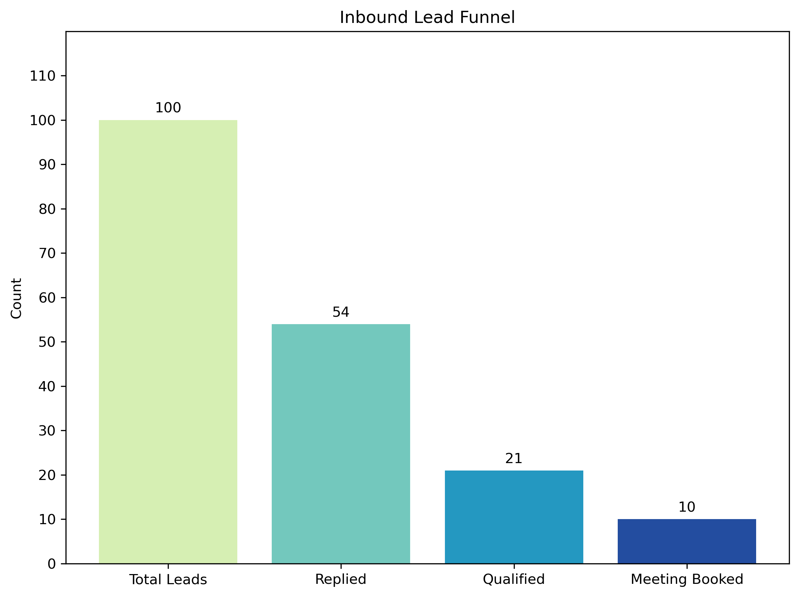
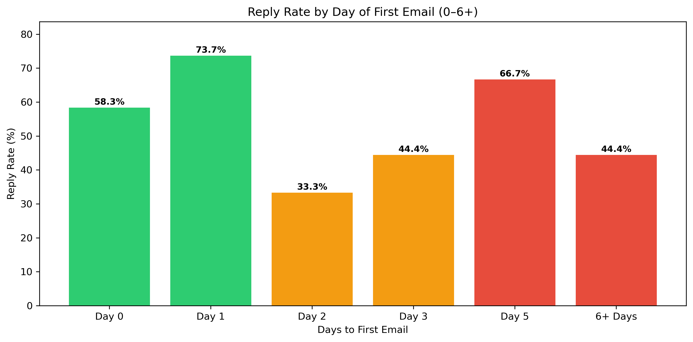
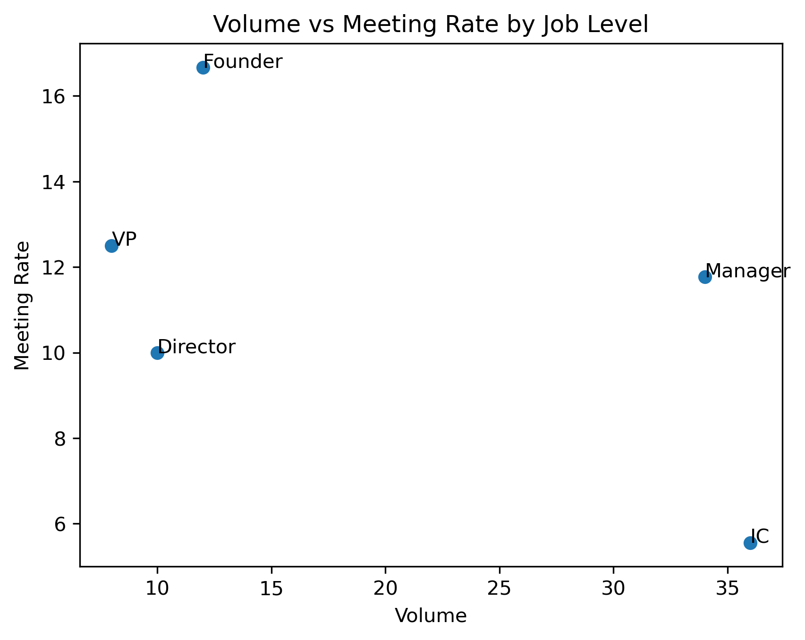
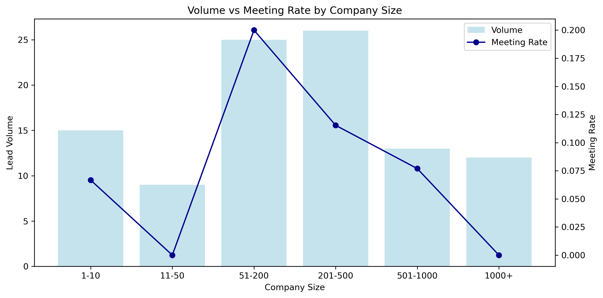
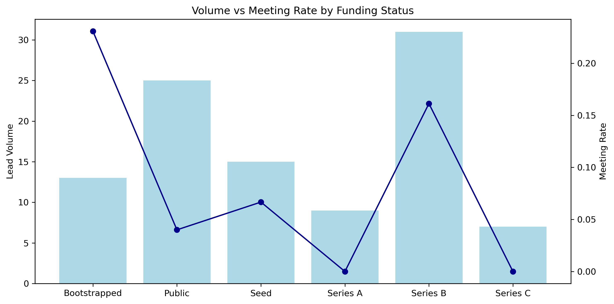
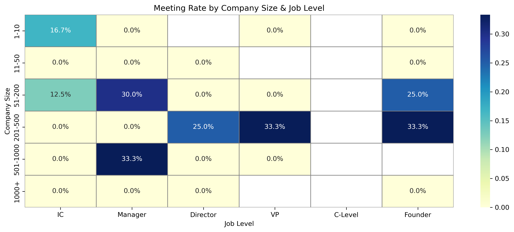

# inbound-lead-funnel-analysis
Inbound lead funnel analysis in Python (pandas): where 100 inbound leads drop off, why the current ICP doesn’t predict meetings, and what to change. Includes report, notebook and cleaned data.

